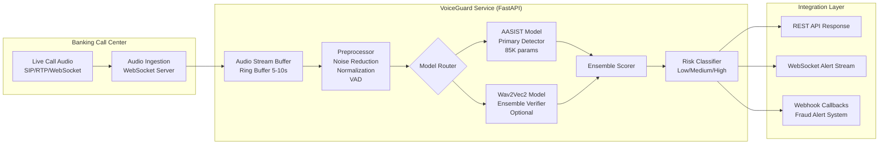
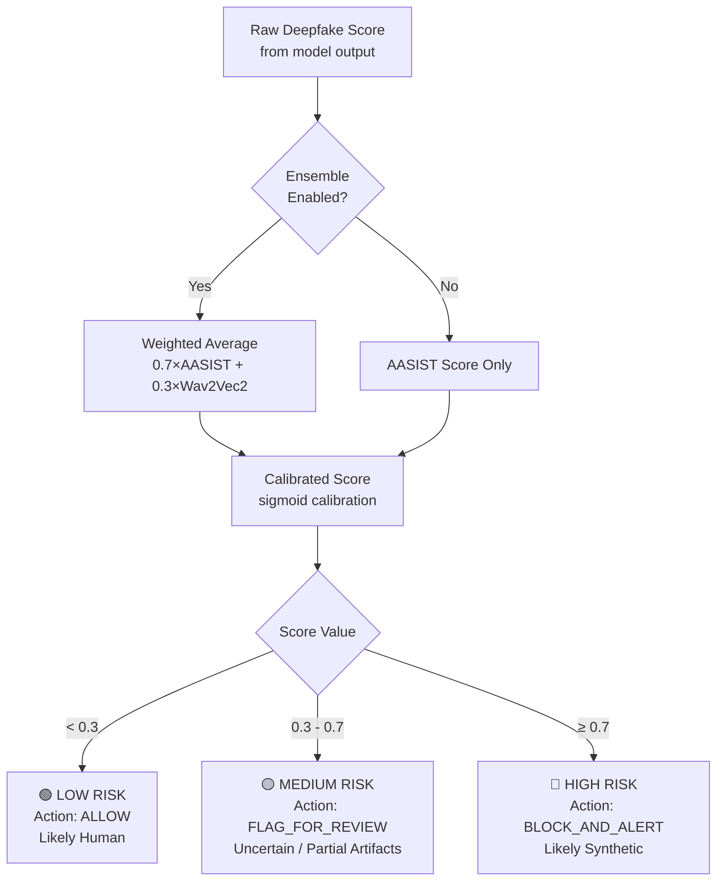

# VoiceGuard — Real-Time AI Voice Deepfake Detection for Banking Call Centers

A production-grade system that analyzes live call audio and detects synthetic speech within the first 10 seconds of a call, using pretrained open-source models.

## Background & Problem

Modern generative AI can clone a person's voice from only a few seconds of audio. Fraudsters exploit this to bypass voice biometric authentication or impersonate customers during phone calls. Current defenses rely on easily-spoofed metadata (phone numbers, caller IDs). This system provides real-time audio-level deepfake detection using state-of-the-art pretrained models.

---

## System Architecture Overview



---

## User Review Required

> [!IMPORTANT]
> **Model Selection**: The plan uses **AASIST-L** (85,306 parameters, EER: 0.99%) as the primary model for its ultra-low latency. The full AASIST (~297K params, EER: 0.83%) is available as an option. Both use the same architecture class — the difference is in config dimensions.

> [!IMPORTANT]
> **Ensemble Mode**: The Wav2Vec2 model from HuggingFace (`Hemgg/Deepfake-audio-detection`) is included as an **optional** ensemble verifier. It adds ~50-80ms latency per inference. It can be disabled for strict <100ms requirements.

> [!WARNING]
> **Pretrained Weights**: The AASIST pretrained weights (`AASIST.pth` / `AASIST-L.pth`) must be downloaded from the [clovaai/aasist](https://github.com/clovaai/aasist) repository. They ship in the repo under `models/weights/`. The Wav2Vec2 model auto-downloads from HuggingFace on first use.

> [!CAUTION]
> **GPU Requirement**: For production <200ms latency, a CUDA-capable GPU is strongly recommended. CPU inference is possible with AASIST-L (~150ms on modern CPUs) but Wav2Vec2 ensemble on CPU will exceed the latency budget.

---

## Proposed Changes

### Component 1: Project Structure & Configuration

#### [NEW] [project structure](file:///home/tielixir/Coding/Projects/deepfake)

```
deepfake/
├── README.md                          # Project documentation
├── pyproject.toml                     # Project metadata & dependencies
├── requirements.txt                   # Pip dependencies
├── Dockerfile                         # Production container
├── docker-compose.yml                 # Multi-service orchestration
├── .env.example                       # Environment variable template
│
├── config/
│   ├── __init__.py
│   ├── settings.py                    # Pydantic settings management
│   ├── aasist.json                    # AASIST model configuration
│   └── aasist_l.json                  # AASIST-L model configuration
│
├── models/
│   ├── __init__.py
│   ├── aasist.py                      # AASIST architecture (from clovaai)
│   └── weights/                       # Pretrained weight files (.pth)
│       └── .gitkeep
│
├── core/
│   ├── __init__.py
│   ├── audio_buffer.py                # Ring buffer for streaming audio
│   ├── preprocessor.py                # VAD, noise reduction, normalization
│   ├── feature_extractor.py           # Spectrogram / raw waveform prep
│   ├── inference_engine.py            # Model inference orchestration
│   ├── ensemble.py                    # Multi-model ensemble scoring
│   └── risk_classifier.py            # Score → Risk level mapping
│
├── api/
│   ├── __init__.py
│   ├── app.py                         # FastAPI application factory
│   ├── routes/
│   │   ├── __init__.py
│   │   ├── health.py                  # Health check endpoints
│   │   ├── analyze.py                 # File upload analysis endpoint
│   │   └── stream.py                  # WebSocket streaming endpoint
│   ├── schemas.py                     # Pydantic request/response models
│   └── middleware.py                  # Auth, CORS, rate limiting
│
├── services/
│   ├── __init__.py
│   ├── alert_service.py               # Fraud alert dispatch
│   └── audit_logger.py               # Compliance audit logging
│
├── scripts/
│   ├── download_weights.py            # Download pretrained weights
│   └── benchmark.py                   # Latency benchmarking script
│
└── tests/
    ├── __init__.py
    ├── test_audio_buffer.py
    ├── test_preprocessor.py
    ├── test_inference.py
    └── test_api.py
```

---

### Component 2: Configuration & Settings

#### [NEW] [settings.py](file:///home/tielixir/Coding/Projects/deepfake/config/settings.py)

Pydantic-based settings management with environment variable overrides:

- `MODEL_VARIANT`: `"aasist"` or `"aasist_l"` (default: `"aasist_l"` for latency)
- `ENABLE_ENSEMBLE`: `bool` (default: `False`) — enables Wav2Vec2 ensemble
- `WAV2VEC2_MODEL_ID`: `str` — HuggingFace model ID (default: `"Hemgg/Deepfake-audio-detection"`)
- `SAMPLE_RATE`: `int` (default: `16000`)
- `BUFFER_DURATION_SEC`: `float` (default: `6.0`) — 6 seconds of audio (~4s effective after padding logic)
- `DEVICE`: `str` (auto-detect CUDA/CPU)
- `MAX_LATENCY_MS`: `int` (default: `200`)
- `RISK_THRESHOLDS`: High/Medium/Low score boundaries
- `WEBHOOK_URL`: Optional alert destination
- `API_KEY_HASH`: Optional API authentication

#### [NEW] [aasist.json](file:///home/tielixir/Coding/Projects/deepfake/config/aasist.json)

Direct adaptation from the upstream `AASIST.conf` config:
```json
{
    "architecture": "AASIST",
    "nb_samp": 64600,
    "first_conv": 128,
    "filts": [70, [1, 32], [32, 32], [32, 64], [64, 64]],
    "gat_dims": [64, 32],
    "pool_ratios": [0.5, 0.7, 0.5, 0.5],
    "temperatures": [2.0, 2.0, 100.0, 100.0]
}
```

#### [NEW] [aasist_l.json](file:///home/tielixir/Coding/Projects/deepfake/config/aasist_l.json)

Lightweight variant (85K params):
```json
{
    "architecture": "AASIST",
    "nb_samp": 64600,
    "first_conv": 128,
    "filts": [70, [1, 32], [32, 32], [32, 24], [24, 24]],
    "gat_dims": [24, 32],
    "pool_ratios": [0.4, 0.5, 0.7, 0.5],
    "temperatures": [2.0, 2.0, 100.0, 100.0]
}
```

---

### Component 3: Audio Pipeline (Core)

#### [NEW] [audio_buffer.py](file:///home/tielixir/Coding/Projects/deepfake/core/audio_buffer.py)

Thread-safe ring buffer for streaming audio accumulation:

- **`AudioStreamBuffer`** class:
  - Accepts incoming PCM chunks (16-bit, 16kHz mono) via WebSocket
  - Internally stores as`float32` numpy array
  - Configurable target duration (default 6s = 96,000 samples)
  - `append(chunk: bytes)` → adds raw PCM to buffer
  - `is_ready() -> bool` → True when buffer has ≥ target samples
  - `get_audio() -> np.ndarray` → returns the buffered audio, applies AASIST padding logic
  - `reset()` → clears buffer for next analysis window
  - Uses `threading.Lock` for thread safety

#### [NEW] [preprocessor.py](file:///home/tielixir/Coding/Projects/deepfake/core/preprocessor.py)

Audio preprocessing pipeline:

- **`AudioPreprocessor`** class:
  - `resample(audio, orig_sr, target_sr=16000)` → resamples if needed using `torchaudio.transforms.Resample`
  - `normalize(audio)` → peak normalization to [-1, 1] range
  - `remove_silence(audio, sr)` → energy-based VAD to trim leading/trailing silence
  - `reduce_noise(audio, sr)` → spectral gating noise reduction (lightweight, ~5ms)
  - `preprocess(audio, sr) -> torch.Tensor` → full pipeline: resample → normalize → VAD → noise reduction → pad/trim to `nb_samp` (64600)

Key design: The AASIST model expects raw waveform input of exactly 64,600 samples (≈4.04s at 16kHz). The preprocessor handles the padding/cropping logic from the upstream `data_utils.py`.

#### [NEW] [feature_extractor.py](file:///home/tielixir/Coding/Projects/deepfake/core/feature_extractor.py)

Feature extraction utilities (for analysis/debugging, not needed by AASIST directly since it works on raw waveform):

- **`FeatureExtractor`** class:
  - `compute_mel_spectrogram(audio, sr)` → for visualization/logging
  - `compute_stft(audio, sr)` → short-time Fourier transform
  - `extract_pitch_contour(audio, sr)` → pitch tracking for supplementary analysis
  - `compute_spectral_statistics(audio, sr)` → centroid, bandwidth, rolloff for logging

> [!NOTE]
> AASIST operates on **raw waveform** — it has its own learned sinc-filter front-end (`CONV` class). The feature extractor is for diagnostic logging and supplementary analysis, not for feeding into the model.

---

### Component 4: Inference Engine

#### [NEW] [inference_engine.py](file:///home/tielixir/Coding/Projects/deepfake/core/inference_engine.py)

Core model inference orchestration:

- **`AASISTInferenceEngine`** class:
  - `__init__(config)` → loads AASIST model weights, sets eval mode, moves to device
  - Uses `torch.no_grad()` and `model.eval()` for inference
  - Applies `torch.jit.trace()` for TorchScript optimization (optional)
  - `infer(audio_tensor: Tensor) -> dict` → returns `{"score": float, "label": str, "latency_ms": float, "embedding": Tensor}`
  - Score is derived from model output: `output[:, 1]` (bonafide score) passed through softmax → probability
  - **Warmup**: Runs 3 dummy inferences at startup to prime CUDA kernels

- **`Wav2Vec2InferenceEngine`** class (optional):
  - `__init__(model_id)` → loads from HuggingFace using `transformers.AutoModelForAudioClassification`
  - `infer(audio_tensor: Tensor) -> dict` → returns classification scores
  - Maps labels: `"fake"` → high risk, `"real"` → low risk

#### [NEW] [ensemble.py](file:///home/tielixir/Coding/Projects/deepfake/core/ensemble.py)

Multi-model ensemble scoring:

- **`EnsembleScorer`** class:
  - Configurable weights: AASIST (primary, weight=0.7), Wav2Vec2 (secondary, weight=0.3)
  - `score(aasist_result, wav2vec2_result=None) -> float` → weighted average
  - Falls back to AASIST-only score when ensemble is disabled
  - Includes confidence calibration using Platt scaling (optional, calibrated on validation set)

#### [NEW] [risk_classifier.py](file:///home/tielixir/Coding/Projects/deepfake/core/risk_classifier.py)

Score-to-risk mapping and alert decision logic:

- **`RiskClassifier`** class:
  - Configurable thresholds (from settings):
    - `score < 0.3` → **LOW** risk (likely human)
    - `0.3 ≤ score < 0.7` → **MEDIUM** risk (uncertain, flag for review)
    - `score ≥ 0.7` → **HIGH** risk (likely synthetic, trigger alert)
  - `classify(score: float) -> RiskAssessment` → returns risk level + recommended action
  - Actions: `"ALLOW"`, `"FLAG_FOR_REVIEW"`, `"BLOCK_AND_ALERT"`

---

### Component 5: API Layer (FastAPI)

#### [NEW] [app.py](file:///home/tielixir/Coding/Projects/deepfake/api/app.py)

FastAPI application factory with lifecycle management:

- Model loading on startup (`@app.on_event("startup")`)
- CORS middleware for banking system integration
- Request ID tracking middleware
- Global exception handlers
- OpenAPI documentation customization

#### [NEW] [schemas.py](file:///home/tielixir/Coding/Projects/deepfake/api/schemas.py)

Pydantic models for API contracts:

```python
class AnalysisRequest(BaseModel):
    call_id: str                    # Unique call identifier
    audio_format: str = "wav"       # wav, pcm, flac
    sample_rate: int = 16000
    encoding: str = "float32"

class AnalysisResult(BaseModel):
    call_id: str
    deepfake_score: float           # 0.0 (human) → 1.0 (synthetic)
    risk_level: str                 # "LOW" | "MEDIUM" | "HIGH"
    recommended_action: str         # "ALLOW" | "FLAG_FOR_REVIEW" | "BLOCK_AND_ALERT"
    confidence: float               # Model confidence
    inference_latency_ms: float     # Processing time
    models_used: list[str]          # ["aasist_l"] or ["aasist_l", "wav2vec2"]
    timestamp: datetime
    spectral_analysis: dict | None  # Optional diagnostic data

class StreamingChunk(BaseModel):
    call_id: str
    chunk_index: int
    audio_data: bytes               # Base64-encoded PCM
    is_final: bool = False

class HealthResponse(BaseModel):
    status: str
    models_loaded: list[str]
    gpu_available: bool
    avg_latency_ms: float
```

#### [NEW] [health.py](file:///home/tielixir/Coding/Projects/deepfake/api/routes/health.py)

Health and readiness endpoints:

- `GET /health` → service health status
- `GET /health/ready` → model readiness check
- `GET /health/metrics` → inference statistics (avg latency, total calls, etc.)

#### [NEW] [analyze.py](file:///home/tielixir/Coding/Projects/deepfake/api/routes/analyze.py)

File upload analysis endpoint:

- `POST /api/v1/analyze` → accepts audio file upload, returns `AnalysisResult`
- Supports WAV, FLAC, PCM formats
- Validates audio duration (minimum 2s, maximum 30s)
- Returns full analysis result with spectral diagnostics

#### [NEW] [stream.py](file:///home/tielixir/Coding/Projects/deepfake/api/routes/stream.py)

WebSocket streaming endpoint for real-time call analysis:

- `WS /api/v1/stream/{call_id}` → bidirectional WebSocket
- Client sends PCM audio chunks (recommended: 500ms chunks)
- Server accumulates in `AudioStreamBuffer`
- Once buffer reaches target duration, triggers inference
- Server pushes `AnalysisResult` back via WebSocket
- Supports continuous monitoring (sliding window analysis every 3s after initial)

**WebSocket Protocol:**
```
Client → Server: {"type": "audio_chunk", "data": "<base64 PCM>", "seq": 1}
Client → Server: {"type": "end_stream"}
Server → Client: {"type": "analysis_result", "data": <AnalysisResult>}
Server → Client: {"type": "buffer_status", "buffered_seconds": 3.2}
```

#### [NEW] [middleware.py](file:///home/tielixir/Coding/Projects/deepfake/api/middleware.py)

Security and observability middleware:

- API key authentication (via `X-API-Key` header)
- Rate limiting (configurable per-client)
- Request/response logging
- CORS configuration for banking system origins

---

### Component 6: Services & Integration

#### [NEW] [alert_service.py](file:///home/tielixir/Coding/Projects/deepfake/services/alert_service.py)

Fraud alert dispatch:

- `send_alert(result: AnalysisResult)` → sends webhook to configured banking system
- Supports multiple alert channels: webhooks, email (SMTP), message queues
- Alert batching and deduplication
- Retry logic with exponential backoff

#### [NEW] [audit_logger.py](file:///home/tielixir/Coding/Projects/deepfake/services/audit_logger.py)

Compliance-grade audit logging:

- Logs every analysis request/result with timestamp, call_id, score, risk level
- Immutable JSON-lines format for forensic analysis
- Configurable retention policies
- No raw audio stored (privacy compliance) — only metadata and scores

---

### Component 7: Deployment & Scripts

#### [NEW] [requirements.txt](file:///home/tielixir/Coding/Projects/deepfake/requirements.txt)

```
torch>=2.0.0
torchaudio>=2.0.0
numpy>=1.24.0
soundfile>=0.12.0
fastapi>=0.104.0
uvicorn[standard]>=0.24.0
websockets>=12.0
python-multipart>=0.0.6
pydantic>=2.5.0
pydantic-settings>=2.1.0
transformers>=4.36.0
noisereduce>=3.0.0
scipy>=1.11.0
librosa>=0.10.0
httpx>=0.25.0
python-jose[cryptography]>=3.3.0
```

#### [NEW] [Dockerfile](file:///home/tielixir/Coding/Projects/deepfake/Dockerfile)

Multi-stage Docker build:
- Stage 1: Python 3.11-slim base with CUDA 12.1 support
- Stage 2: Install dependencies, copy model weights
- Stage 3: Production image with uvicorn
- Health check endpoint for container orchestration
- Non-root user for security

#### [NEW] [docker-compose.yml](file:///home/tielixir/Coding/Projects/deepfake/docker-compose.yml)

```yaml
services:
  voiceguard:
    build: .
    ports:
      - "8000:8000"
    environment:
      - MODEL_VARIANT=aasist_l
      - ENABLE_ENSEMBLE=false
      - DEVICE=cuda
    deploy:
      resources:
        reservations:
          devices:
            - driver: nvidia
              count: 1
              capabilities: [gpu]
    volumes:
      - ./models/weights:/app/models/weights
      - ./logs:/app/logs
    healthcheck:
      test: ["CMD", "curl", "-f", "http://localhost:8000/health"]
      interval: 30s
      timeout: 10s
      retries: 3
```

#### [NEW] [download_weights.py](file:///home/tielixir/Coding/Projects/deepfake/scripts/download_weights.py)

Script to download pretrained AASIST weights:
- Clones the clovaai/aasist repo (sparse checkout of weights directory only)
- Downloads Wav2Vec2 model from HuggingFace (if ensemble enabled)
- Validates checksum integrity

#### [NEW] [benchmark.py](file:///home/tielixir/Coding/Projects/deepfake/scripts/benchmark.py)

Latency benchmarking:
- Generates synthetic test audio
- Measures end-to-end pipeline latency (preprocessing + inference)
- Reports P50, P95, P99 latencies
- Compares AASIST vs AASIST-L vs ensemble configurations
- Tests both CPU and GPU (if available)

---

## Latency Optimization Strategy

| Technique | Expected Savings | Implementation |
|---|---|---|
| **AASIST-L model** (85K params vs 297K) | ~40% faster inference | Config selection |
| **TorchScript tracing** (`torch.jit.trace`) | ~15-25% faster | Applied at model load |
| **CUDA kernel warmup** | Eliminates cold-start spike | 3 dummy inferences at startup |
| **Half-precision** (`torch.float16`) on GPU | ~30% faster, lower memory | Configurable setting |
| **Pre-allocated tensors** | Avoids allocation overhead | Buffer reuse in inference loop |
| **Async preprocessing** | Overlaps I/O with compute | `asyncio` in WebSocket handler |
| **Lightweight noise reduction** | ~5ms vs ~50ms full pipeline | Spectral gating only |

**Expected Latencies:**

| Configuration | GPU (V100/A100) | GPU (RTX 3060) | CPU (Modern i7) |
|---|---|---|---|
| AASIST-L only | 15-25ms | 25-40ms | 120-180ms |
| AASIST full only | 30-50ms | 50-80ms | 200-350ms |
| AASIST-L + preprocessing | 25-40ms | 40-60ms | 140-200ms |
| AASIST-L + Wav2Vec2 ensemble | 80-120ms | 120-180ms | 500ms+ |

---

## Risk Scoring Logic



The AASIST model outputs 2 logits: `[spoof_score, bonafide_score]`. We convert to a deepfake probability:
```python
# Model output: (last_hidden, output) where output shape = (batch, 2)
# output[:, 0] = spoof logit, output[:, 1] = bonafide logit
probs = torch.softmax(output, dim=1)
deepfake_score = probs[:, 0].item()  # probability of being spoofed/synthetic
```

---

## Open Questions

> [!IMPORTANT]
> **Q1: GPU Availability** — Do you have a CUDA-capable GPU on the target deployment machine? This determines whether we optimize for GPU or CPU inference paths.

> [!IMPORTANT]
> **Q2: Wav2Vec2 Ensemble** — Should the Wav2Vec2 ensemble model be included in the initial implementation, or should we start with AASIST-only for simplicity and add it later?

> [!NOTE]
> **Q3: Integration Protocol** — For the banking system integration, do you prefer the WebSocket streaming interface, the REST file-upload interface, or both?

---

## Verification Plan

### Automated Tests
```bash
# Unit tests
pytest tests/ -v

# Latency benchmark
python scripts/benchmark.py --model aasist_l --device cpu --iterations 100

# API integration test
pytest tests/test_api.py -v

# Docker build verification
docker-compose build && docker-compose up -d
curl http://localhost:8000/health
```

### Manual Verification
- Upload a known bonafide audio sample → expect LOW risk score
- Upload a known TTS-generated audio sample → expect HIGH risk score
- WebSocket streaming test with simulated live audio chunks
- Verify inference latency is within 200ms budget
